# Technical plan

Status: **draft for Sarah's review** (2026-10-28). Product spec: [Snoozle's Garden: Build Spec](https://claude.ai/artifact/9GVosVjYu739Cb4ncPLCQC)
(the spec wins on behaviour and copy; this doc wins on how it's built). Defaults marked ★ await an answer in
[Open questions](#10-open-questions).

## TL;DR

- One static `index.html` (inline CSS + vanilla JS, no framework, no build) on **Cloudflare Pages**, deployed on
  every push to a private GitHub repo. $0 and nothing to upgrade.
- State lives in memory and resets at local midnight. **Only Future moves are stored** (one `localStorage` key).
  No name, no friendship, no accounts, no server ([§3](#3-state)).
- Load budget: **≤ 20 KB brotli HTML, ≤ 70 KB total transfer, LCP ≤ 2.0 s on Slow 4G**. Measured: the prototype is
  13 KB brotli; fonts add 44 KB ([§5](#5-load-time)).
- Deviations from the spec (Sarah, 2026-10-28): no renaming; accessibility section deferred to Later.
- Animations: cut the menu morph (~30 lines, ~0.7 s wait on every menu tap) for an instant swap; keep the ones that
  carry meaning ([§6](#6-animation-audit)).
- Build in 4 milestones, each closed by `npm run gate` ([§8](#8-milestones)).

**Terms:** **Pages** = Cloudflare's static hosting with Git deploys. **Brotli** = the compression Cloudflare serves
to browsers. **LCP** = Largest Contentful Paint, when the main content is drawn. **FCP** = First Contentful Paint.
**CLS** = Cumulative Layout Shift. **Slow 4G** = Lighthouse's mobile profile: 150 ms round trip, 1.6 Mbps down,
4× CPU slowdown. **RTT** = one network round trip. **N / B** = today's comfortable moves / the person's usual (spec
terms). **Gate** = the check script run before each commit.

## 1. Overview

```mermaid
flowchart LR
  U[Tap / input] --> A[act&#40;type, arg&#41;]
  A --> S[(state: day)]
  A --> F[(futureMoves)]
  F -- save --> L[(localStorage<br/>snoozle:v1)]
  S --> R[render&#40;&#41;]
  F --> R
  A --> E[effects: hop, hearts, phew]
  R --> SC[scene + Snoozle SVG]
  R --> D[dialog typer]
  R --> P[screen panel]
  C[clock: load, visibilitychange, 60 s] -- new date --> A
```



One page, one script. Every user action goes through `act()`, which changes state, then calls `render()` and
fires at most one effect. Nothing changes outside `act()`, which is how "every tap gets immediate, visible
feedback" stays true.

| Choice | Why | Wrong if… (then) |
|---|---|---|
| One `index.html`, no build | Zero dependencies to update; works from `file://`; the prototype already proves the shape (789 lines) | The file passes ~1,800 lines or Backlog features need shared code (then ES modules + esbuild; loses `file://`) |
| Vanilla JS, re-render the panel per action | ~40 controls; a framework would add 40+ KB and a build | Re-render visibly drops focus or input text (then patch only changed nodes) |
| Cloudflare Pages ★ | Private-repo Git deploys at $0, Brotli, edge cache | Cloudflare retires Pages for new projects (then Workers static assets, same files) |

## 2. Code layout inside `index.html`

Sections in this order, each behind a `// ── NAME ──` comment so an agent can jump to them:

| Section | Holds | Rule |
|---|---|---|
| `TOKENS` (CSS) | Spec colour tokens, light + `prefers-color-scheme: dark` | Every colour is a variable; no hex outside this block |
| `COPY` | Every user-visible string from the spec, as one object | Strings appear nowhere else in the script; the gate checks them against `spec/copy.json` |
| `STATE` | `newDay()` defaults + `day` object + `futureMoves` | Only `act()` mutates |
| `STORE` | `loadFuture()` / `saveFuture()` | Wrapped in try/catch; app works if storage throws |
| `CLOCK` | Date check on load, `visibilitychange`, every 60 s | New date → `act('newDay')` |
| `ACT` | One function per action in the spec tables | Returns nothing; ends with `render()` |
| `RENDER` | Scene, backpack, friendship line, panel per screen | Built with a 10-line `el(tag, attrs, ...kids)` helper: user text becomes text nodes, never `innerHTML`. Each screen's skeleton (headings, inputs) is built once; `render()` replaces only its lists and labels, so a typed draft and keyboard focus survive every action |
| `FX` | Hop, hearts, ✨, phew, strain, menu morph | Respects `prefers-reduced-motion` (cheap to keep; spec behaviour) |
| `DIALOG` | Typer (18 ms/char), tap to skip, `▾` | One typer at a time; a new line cancels the old |

Events: one delegated `click` listener reads `data-act="…"` and `data-arg="…"`; Enter in the move input = Teach.
The move input calls `scrollIntoView({block: "center"})` on focus so the iPhone keyboard doesn't hide it. With
renaming gone, no bottom sheet holds an input. Avoid `100vh`, because iOS toolbars make it taller than the screen.

## 3. State

| Field | Lives | Reset |
|---|---|---|
| `date` (YYYY-MM-DD, local) | memory | new day |
| `sky`, `water`, `tapped` (Recharge cards), `moves` (`{text, used}`), `friendship`, `usual` (B, default 4), `screen` | memory | new day and on refresh |
| `futureMoves` (array of strings, ≤ 40 chars each) | memory + `localStorage` key `snoozle:v1` as `{"v":1,"future":[…]}` | never automatically; only "Let go" or "Bring back" removes one |

- **Not stored, by decision:** name (no renaming), friendship (6 lines, reachable within one day), usual, the day.
- **Consequence:** a mid-day refresh or a phone closing the tab returns to the first-visit greeting with an empty
  day (Future moves stay). Accepted for v1; Export today ([PLAN Next](PLAN.md#next)) is how a person keeps a day.
- `usual` resets to 4 each day, so the stepper must be re-set daily by someone whose usual differs ★ ([Q2](#10-open-questions)).
- Storage failure (private mode, `file://` in some Safari builds): Future moves work for the session, silently.
  No error copy; the spec has none.
- All writes go through one `setFuture(list)`, which saves; no other code touches storage.
- Reading validates: an array of strings, each trimmed to 40 chars, at most 50 kept. Anything else reads as empty.
- Schema version `v` lets a later field be added. An unknown `v` (a newer build) is neither read nor overwritten.
- Two open tabs: the `storage` event reloads `futureMoves` in the other tab, so neither overwrites the other's save.
- "Reset prototype" clears the day only, as the spec says. Future moves are not part of the day.
- **Top UX risk:** iPhone Safari discards background tabs under memory pressure. A person who teaches moves in the
  morning may find an empty day in the afternoon (Future moves survive). If that shows up in use, the cheapest fix
  is the spec's own: mirror the day under a date key, cleared at midnight (~10 lines). Sarah's call ([Q3](#10-open-questions)).

## 4. Hosting and cost

| Item | Choice | Cost |
|---|---|---|
| Repo | GitHub `schen22/snoozle`, private | $0 |
| Host | Cloudflare Pages, Git integration, no build command, output directory `/` | $0 (500 builds/month on the free plan; we'll use < 30) |
| Domain | `snoozle.pages.dev` (or the next free subdomain) | $0 |
| Fonts | Google Fonts (spec) | $0; sends the visitor's IP to Google |
| Maintenance | No dependencies at runtime; dev-only `puppeteer-core` for the gate | ~0 h/month |

Preview deploys: each branch gets its own `*.pages.dev` URL, so a change can be checked on a phone before merge.
Rollback: Pages keeps every deployment; "Rollback" in the dashboard restores one in seconds.

**The site is public.** A private repo hides the code, not the page: anyone with the `pages.dev` URL can open it,
and search engines can find it. To make the page itself private, put Cloudflare Access in front (free up to 50
users, email one-time code, no code change) ★ ([Q8](#10-open-questions)). Either way, ship a `_headers` file:

```text
/*
  Content-Security-Policy: default-src 'none'; script-src 'unsafe-inline'; style-src 'unsafe-inline' https://fonts.googleapis.com; font-src https://fonts.gstatic.com; img-src data:; base-uri 'none'; form-action 'none'; frame-ancestors 'none'
  X-Content-Type-Options: nosniff
  Referrer-Policy: no-referrer
```

`'unsafe-inline'` is the price of one self-contained file; the rule that user text is never parsed as HTML
([§2](#2-code-layout-inside-indexhtml)) is what actually prevents injection. The policy still blocks any network
call the spec doesn't allow.

## 5. Load time

Budget, checked as computed values, never by eye:

| Metric | Budget | Measured / estimated | How checked |
|---|---|---|---|
| `index.html` brotli | ≤ 20 KB | prototype 13.0 KB (46.4 KB raw, 14.8 KB gzip) | `gate:fast`: `scripts/budget.mjs` compresses and compares |
| Total transfer, first load | ≤ 70 KB | ~13 + 1.6 (font CSS) + 39.2 (Nunito, one variable file for 400/600/800) + 4.7 (Press Start 2P) ≈ **59 KB** | `npm run perf` |
| FCP, Slow 4G | ≤ 1.5 s | ~1.0 s (below) | `npm run perf` |
| LCP, Slow 4G | ≤ 2.0 s | ~1.0–1.3 s | same |
| CLS | ≤ 0.1 | unknown: font swap may shift the dialog | same |
| Lighthouse performance | ≥ 95 | — | same |

**Arithmetic (and what it assumes):** connection to Cloudflare ≈ 3 RTT (DNS, TCP, TLS) = 450 ms, request 150 ms,
13 KB at ~200 KB/s ≈ 65 ms → HTML at ~0.7 s. The font stylesheet is render-blocking: +1 RTT on an already
preconnected origin → FCP ≈ 0.85–1.0 s. Font files: +1 RTT + 44 KB ≈ 0.4 s → swap at ~1.2 s. It assumes the
preconnect hints finish before the CSS is requested and that Cloudflare's edge is ≤ 1 RTT away.

**Refuted if** Lighthouse reports FCP > 1.5 s or CLS > 0.1. Fixes, in order of cost:

1. Load the font CSS without blocking (`media="print" onload="this.media='all'"`) and size the fallback to
   Nunito's metrics (`size-adjust`) to keep CLS down.
2. Self-host the two `woff2` files on Pages (same origin: saves 2 connections, ~300–600 ms on Slow 4G; drops the
   Google IP leak). Cost: 3 files instead of 1, fonts fall back to system on `file://`.
3. Drop Press Start 2P (4.7 KB, one name tag) for a system monospace.

Inline SVG for the scene and Snoozle: no image requests. No JS runs before first paint except the theme tokens (CSS).

## 6. Animation audit

Rule: an animation stays if it **carries meaning the spec relies on** (weather, strain, relief, growth) and costs
only CSS. It goes if it delays content, needs layout measuring in JS, or has a race. Line counts are from the
prototype.

| Animation | Cost | Value | Verdict |
|---|---|---|---|
| **Menu morph**: ▸ blinks twice → 320 ms wait → others fade (200 ms) → a ghost chip flies to the Back row (360 ms, Web Animations + `getBoundingClientRect`) → content fades up (300 ms) | ~30 lines JS + CSS; **~0.7–1.0 s before the screen is usable, on every menu tap**; a second tap within 320 ms spawns a second ghost; separate reduced-motion branch; gate flows must wait it out | Low: decoration on navigation, and the hop + typed line already answer the tap | **Cut ★.** Instant swap: menu hides, Back row + label chip show, content fades up in 150 ms (CSS only) |
| ▸ cursor blinking twice | 1 keyframe, but only worth it with the wait above | Low | **Cut**: a static ▸ on the chip is enough |
| Dialog typer (18 ms/char, tap to skip) | ~20 lines; a 120-char line takes ~2.2 s | High: the retro dialog voice | Keep; a new line cancels the old one |
| Sky motions (bounce, sway, droop, breathing) | 4 CSS keyframes | High: the check-in's whole reply | Keep |
| Rain + lightning | One SVG element per drop, infinite; costs CPU on low-end phones | High on rainy days | Keep, cap at 24 drops, animate `transform` only |
| Leaf shelter rising/sinking | CSS transition | Medium: says rain without words | Keep |
| Plant pop + ✨ | 1 keyframe, class reset | High: the reward for care | Keep |
| Floating 💗 💤 💞 💨 "phew~" | One spawn helper + 1.6 s removal timer | Medium | Keep; one `float(emoji, at)` helper, ≤ 4 at once |
| Backpack bundle pop | 1 keyframe | Medium | Keep |
| Strain (infinite tremble + face swap) | 1 keyframe + 3 SVG parts shown | High: the only sign of going over N besides the border | Keep the face swap; tremble is optional if it looks busy |
| Relief stretch | 1 keyframe | High: "doing less earns the warmest reaction" | Keep |
| Sit-down breather (1.3 s) | 1 keyframe | Low–medium | Keep: costs nothing |
| Friendship line flash | 1 keyframe | Medium | Keep |
| Tall-grass rustle (Thoughts) | 1 keyframe | Low | Keep only if free; first to cut |
| Bottom-sheet pop-ups | CSS transform | Medium | Keep at 200 ms, no JS timing |

Effect: about 30 fewer lines, no JS layout measuring, and every screen opens on the same frame as the tap. All
remaining motion is CSS classes added by `FX`. Each one keeps working with reduced motion, because state never
waits on an animation.

## 7. Gates

| Command | Runs | Time |
|---|---|---|
| `npm run gate:fast` | Docs links (`check-docs.mjs`) · brotli budget · every `spec/copy.json` string present in `index.html` · no hex colour outside `TOKENS` · no digits in `COPY` except N, B and the stepper | < 2 s |
| `npm run gate` | `gate:fast` + puppeteer-core with installed Chrome at 320, 390, 460 px: no horizontal scroll, tap targets ≥ 44 px, **zero `pageerror` or console errors**, the spec's acceptance criteria as scripted flows (menu → screen → Back, skies, plant stages, teach past N, save/let go, Future moves survive reload, a corrupt `snoozle:v1` reads as empty, midnight reset with a faked clock) | < 30 s |
| `npm run perf` | `npx lighthouse` (mobile preset, simulated Slow 4G) with the installed Chrome against the local server; prints FCP, LCP, CLS, score, bytes. Fonts load from Google for real | ~30 s, needs network for fonts; run at each milestone |

`spec/copy.json` is extracted from the spec once, in M1, as `{key: string}`. A string with a placeholder
(`{move}`, N, B, `{sky}`) is stored as its fixed fragments, and each fragment must appear. When the spec's copy
changes, update `copy.json` in the same commit as `index.html`.

Not PageSpeed Insights: tested 2026-10-28, keyless calls fail on a shared daily quota, and it can't reach a page behind Access.

A runtime error stops the page, and there's no logging by design (no analytics). The zero-console-error gate is
what catches errors, so every scripted flow counts.

Each prints ≈ 5 lines. Reuse `openAt` and `VIEWPORTS` from sarahs-corner's `test/helpers.js` (serve over HTTP,
installed Chrome, no browser download). No screenshots in helpers; visual sign-off is Sarah's.

## 8. Milestones

| Milestone | Scope | Done when |
|---|---|---|
| M0 Plan | `CLAUDE.md`, `PLAN.md`, this doc, expert review, repo | Sarah approves this doc |
| M1 Shell | `index.html` from the prototype; tokens; scene + Snoozle SVG; Home, menu, Back; dialog typer; clock; `spec/copy.json`; gates; Pages deploy | Home works on a phone at the Pages URL; gate passes; perf printed |
| M2 Care | Garden (skies, rain, leaf shelter, plant stages) and Recharge Center; friendship line | Their acceptance criteria pass in `gate` |
| M3 Moves | Move tutor, backpack and strain, pop-ups, Future moves + storage | Teach past N never blocks; Future moves survive reload |
| M4 Thoughts | Thoughts screen and its routes into Recharge/Moves; tap Snoozle; final perf | Every spec acceptance criterion (minus renaming and accessibility) passes |

## 9. Trade-offs taken

| Chose | Over | Because | Cost |
|---|---|---|---|
| Store Future moves only | Store the whole day | Least data on the device; matches "missing a day costs nothing" | A refresh wipes today |
| No renaming | Rename + store the name | One less screen, no stored identity | Spec copy for renaming dropped |
| Defer accessibility | Spec's full section now | Sarah's call, 2026-10-28: ship the experience first | Screen readers and keyboard users underserved until Later; `aria-live`, real `<button>`s and reduced motion kept because they cost nothing |
| Instant screen swap ★ | Spec's menu morph | ~0.7 s faster per tap, no JS layout code, no double-tap race | Less "handheld menu" charm |
| Google Fonts | Self-hosted fonts | Spec; one file | 2 extra connections, IP to Google |
| Hand-written `act()` + `render()` | A tiny framework (Preact, Alpine) | No dependency, no build | Discipline: no DOM edits outside `render()` / `FX` |

## 10. Open questions

| # | Question | Default ★ | Blocks |
|---|---|---|---|
| 1 | Cloudflare Pages or Workers static assets? (food-planner chose Workers as Cloudflare's path for new projects) | Pages: Git-connect with no config | M1 deploy |
| 2 | Should `usual` (B) also be stored? It's one number and resets to 4 daily otherwise | No (Sarah: store as little as possible) | M3 |
| 3 | Mid-day refresh or iPhone tab discard wipes the day ([§3](#3-state)): acceptable for v1? | Yes; revisit after a week of use | M1 |
| 4 | "About four" in the over-limit pop-up: keep hard-coded or say B? | Keep (spec v1) | M3 |
| 5 | Snorlax/Ditto in the cloudy line: keep? Only safe while the page is private ([Q8](#10-open-questions)) | Keep if Access is on; else the spec's "sleepy giant / blob" line | M2 |
| 6 | A gentle support link for crisis days (spec risk) | Not in v1 | — |
| 7 | Cut the menu morph and cursor blink (spec "Selecting an option", [§6](#6-animation-audit))? | Yes: instant swap + 150 ms fade | M1 |
| 8 | Should the page itself be private (Cloudflare Access, [§4](#4-hosting-and-cost)) or public by URL? | Private with Access | M1 deploy |
