# Technical plan

Status: **draft for Sarah's review** (2026-10-28). Product spec: [Snoozle's Garden: Build Spec](https://claude.ai/artifact/9GVosVjYu739Cb4ncPLCQC)
(the spec wins on behaviour and copy; this doc wins on how it's built). Defaults marked ★ await an answer in
[Open questions](#10-open-questions).

## TL;DR

- One static `index.html` (inline CSS + vanilla JS, no framework, no build) on **Cloudflare Pages**, deployed on
  every push to a private GitHub repo. $0 and nothing to upgrade.
- State lives in memory and resets at local midnight. **Only Future moves are stored** (one `localStorage` key).
  No name, no friendship, no accounts, no server ([§3](#3-state)).
- Load budget: **≤ 20 KB brotli HTML, ≤ 70 KB total transfer, LCP ≤ 2.0 s on Slow 4G**. Measured: the prototype is
  13 KB brotli; fonts add 44 KB ([§5](#5-load-time)).
- Deviations from the spec (Sarah, 2026-10-28/29): no renaming; accessibility deferred; menu morph cut.
- **Export and load** replace stored state: a "Garden Code" in a text the person keeps (notes app, message to self),
  pasted back to restore friendship, thoughts, Future moves and today. Reuses the dragons game's Dispatch Code
  ([§3](#export-and-load)). Accounts and server state are Later.
- Animations: cut the menu morph (~30 lines, ~0.7 s wait on every menu tap) for an instant swap; keep the ones that
  carry meaning ([§6](#6-animation-audit)).
- Build in 4 milestones, each closed by `npm run gate` ([§8](#8-milestones)).

**Terms:** **Pages** = Cloudflare's static hosting with Git deploys. **Brotli** = the compression Cloudflare serves
to browsers. **LCP** = Largest Contentful Paint, when the main content is drawn. **FCP** = First Contentful Paint.
**CLS** = Cumulative Layout Shift. **Slow 4G** = Lighthouse's mobile profile: 150 ms round trip, 1.6 Mbps down,
4× CPU slowdown. **RTT** = one network round trip. **N / B** = today's comfortable moves / the person's usual (spec
terms). **Gate** = the check script run before each commit.

## 1. Overview

```mermaid
flowchart LR
  U[Tap / input] --> A[act&#40;type, arg&#41;]
  A --> S[(state: day)]
  A --> F[(futureMoves)]
  F -- save --> L[(localStorage<br/>snoozle:v1)]
  S --> R[render&#40;&#41;]
  F --> R
  A --> E[effects: hop, hearts, phew]
  R --> SC[scene + Snoozle SVG]
  R --> D[dialog typer]
  R --> P[screen panel]
  C[clock: load, visibilitychange, 60 s] -- new date --> A
```



One page, one script. Every user action goes through `act()`. It derives the view before and after the change,
renders, then picks effects by comparing the two ([§3](#action-pipeline)). Nothing changes outside `act()`, which
is how "every tap gets immediate, visible feedback" stays true.

| Choice | Why | Wrong if… (then) |
|---|---|---|
| One `index.html`, no build | Zero dependencies to update; works from `file://`; the prototype already proves the shape (789 lines) | The file passes ~1,800 lines or Backlog features need shared code (then ES modules + esbuild; loses `file://`) |
| Vanilla JS, re-render the panel per action | ~40 controls; a framework would add 40+ KB and a build | Re-render visibly drops focus or input text (then patch only changed nodes) |
| Cloudflare Pages | Private-repo Git deploys at $0, Brotli, edge cache | Cloudflare retires Pages for new projects (then Workers static assets, same files) |

## 2. Code layout inside `index.html`

Sections in this order, each behind a `// ── NAME ──` comment so an agent can jump to them:

| Section | Holds | Rule |
|---|---|---|
| `TOKENS` (CSS) | Spec colour tokens, light + `prefers-color-scheme: dark` | Every colour is a variable; no hex outside this block |
| `COPY` | Every user-visible string from the spec, as one object | Strings appear nowhere else in the script; the gate checks them against `spec/copy.json` |
| `STATE` | `newDay()` defaults + `day` object + `futureMoves` | Only `act()` mutates |
| `STORE` | `loadFuture()` / `saveFuture()` | Wrapped in try/catch; app works if storage throws |
| `CLOCK` | Date check on load, `visibilitychange`, every 60 s | New date → `act('newDay')` |
| `ACT` | One function per action in the spec tables | Returns nothing; ends with `render()` |
| `RENDER` | Scene, backpack, friendship line, panel per screen | Built with a 10-line `el(tag, attrs, ...kids)` helper: user text becomes text nodes, never `innerHTML`. Each screen's skeleton (headings, inputs) is built once; `render()` replaces only its lists and labels, so a typed draft and keyboard focus survive every action |
| `FX` | Body reactions, particles, plant pop ([§6](#motion-system)) | One `play()` wrapper: Web Animations for one-shots, CSS classes for loops; returns at once with reduced motion |
| `DIALOG` | Typer (18 ms/char), tap to skip, `▾` | One typer at a time; a new line cancels the old. Types into an `aria-hidden` span; the full line goes to a visually hidden `aria-live` span once |

**Sprites are kept from the prototype as drawn.** The scene (sky, sun, clouds, bolt, ground, tufts, leaf shelter),
Snoozle (body, leaves, feet, open/closed eyes, cheeks, happy/strain mouths, brows, sweat, "z z"), the backpack and
bundles, and the four plant stages (`plantSVG()`) are copied with their paths, coordinates and class names
unchanged. The only structural change: Snoozle's parts move from `#buddy-inner` into the nested motion groups
([§6](#motion-system)), with no shape edited. Source of truth: [reference/prototype.html](reference/prototype.html)
(version `1793255127-8d01`, sha256 `b1ecc2e4…`). `gate:fast` checks that every SVG shape in the prototype
(element + geometry attributes) still appears in `index.html`, so a redraw has to be deliberate: update the
reference in the same commit and say why.

Events: one delegated `click` listener reads `data-act="…"` and `data-arg="…"`; Enter in the move input = Teach.
The move input calls `scrollIntoView({block: "center"})` on focus so the iPhone keyboard doesn't hide it. With
renaming gone, no bottom sheet holds an input. Avoid `100vh`, because iOS toolbars make it taller than the screen.

## 3. State

State holds **facts only**. Anything that can be computed from them is derived on every render, never stored, so it
can't drift.

| Fact | Lives | Reset |
|---|---|---|
| `date` (YYYY-MM-DD, local) | memory | new day |
| `sky` (or none), `care` (Recharge taps today), `cared` (set of cards tapped), `moves` (`{id, text, used}`), `bond` (set of distinct acts, below), `usual` (B, default 4), `screen`, `sheet` (open pop-up or none) | memory | new day and on refresh |
| `futureMoves` (array of strings, ≤ 40 chars each) | memory + `localStorage` key `snoozle:v1` as `{"v":1,"future":[…]}` | never automatically; only "Let go" or "Bring back" removes one |

### Derived values

| Value | Formula | Replaces |
|---|---|---|
| `water` | sky water (sunny/cloudy 1, drizzly/stormy 2, none 0) + `care` | Swapping water on a sky change: changing `sky` is enough |
| `stage` | seed 0 · sprout 1–2 · bud 3–4 · bloom ≥ 5 | — |
| `N` | spec table from `sky` and `usual` (no sky → B) | — |
| `unfinished` | moves not used | — |
| `heavy` | `unfinished > N` | Strain on/off, pink borders |
| `friendship` | size of `bond` | A counter that tapping can farm |
| `line` | the highest friendship line reached | — |

`bond` is a set of distinct acts: `sky` (first pick of the day), `care:<card>` (first tap of each card), and
`thought:<n>` (each thought named). A day reaches at most 1 + 8 + thoughts. Repeat taps still water the plant and
get Snoozle's alternating replies (the spec's soft limits), but they don't buy friendship. This needs Sarah's
yes, since the spec says every tap adds 1 ([Q9](#10-open-questions)).

### Action pipeline

```text
act(type, arg):
  before = derive(state)
  REDUCERS[type](state, arg)        // mutate facts only
  after  = derive(state)
  render(after)                     // same frame as the tap
  say(lineFor(type, arg, before, after))
  fx(effectsFor(type, before, after))
```

- `effectsFor` is a pure function: one **body reaction** (highest priority wins, [§6](#motion-system)) plus any
  **accents**: 💗/💤/💞 particles, ✨, plant pop when `after.stage > before.stage`, friendship-line flash when
  `after.line > before.line`. The gate tests it without a browser.
- `lineFor` picks one line per action. A stage-up appends " Look, our plant grew!". A thought option that opens
  another screen keeps its own line, so the screen's intro line is skipped for that navigation (`go(screen, {quiet:true})`).
- Moves carry an `id` from a counter, so duplicates ("walk" twice) stay distinct in "Which one can wait?".
- `newDay` and "Reset prototype": close any sheet, cancel the typer and every running animation
  (`document.getAnimations()`), then reset facts and greet.

### Export and load

The person owns their history; the page keeps none of it. Pattern and code reused from the dragons game's
Dispatch Code (`doodles/dragons/public/engine.js`, `toCode` / `fromCode` / `migrate`, ~20 lines).

**What's exported** (one JSON object, `v: 1`):

| Part | Holds | Restored on load |
|---|---|---|
| Lasting | `bond` (friendship acts, kept across days as a running set of `date:act`), `usual`, `futureMoves`, `thoughts` | Always |
| Today | `date`, `sky`, `care`, `cared`, `moves` | Only when the code's `date` is today |

`thoughts` is a new fact: `{date, time, kind, choice, text?}` per thought named (text only when typed, ≤ 200 chars).
The spec's v1 rule "typed thoughts are not kept" changes to "kept in memory for the day and in exports only".
The log keeps the newest 60 thoughts, so a code stays under ~8 KB.

**Format:** `SNZ1.<fnv32 checksum>.<base64 UTF-8 JSON>`, as in dragons. The checksum catches a code truncated by a
notes app. A load validates with the same rules as storage ([§3](#3-state): types, lengths, caps), runs
`migrate(v)`, and renders text as text nodes. Anything invalid gives one gentle line and changes nothing.

**One export, two uses:** the exported text is readable Markdown (the spec's "Export today" moments: sky, care,
plant stage, friendship line, moves used/saved/let go, thoughts) with the code on its last line. Load accepts the
whole text pasted back and finds the `SNZ1.` code in it. So the person's notes are both a diary and a backup.

| Control | Where | Does |
|---|---|---|
| "Export" link | Home, beside Reset prototype | Opens a bottom sheet: **Share** (`navigator.share`, phones) · **Copy** (clipboard) · **Download** (`.md` file, desktop fallback) |
| "Load" link | Same row | Bottom sheet with a paste box + **Load**. Confirms in Snoozle's voice what came back |

- Friendship across days: with a loaded code, `bond` keeps earlier days' acts, so the higher lines ("every kind of
  weather together") become reachable honestly, over many days and only for someone who keeps their code.
- Privacy: the code is base64, not encrypted. Anyone holding it can read the thoughts in it. No server ever sees it.
  The Export sheet says so in one line ([Q11](#10-open-questions)).
- Copy for both sheets is new (the spec has none). Drafts go to Sarah before M5 ([Q11](#10-open-questions)).

- **Not stored, by decision:** name (no renaming), friendship (6 lines, reachable within one day), usual, the day.
- **Consequence:** a mid-day refresh or a phone closing the tab returns to the first-visit greeting with an empty
  day (Future moves stay). Accepted for v1; Export today ([PLAN Next](PLAN.md#next)) is how a person keeps a day.
- `usual` resets to 4 each day, so the stepper must be re-set daily by someone whose usual differs ★ ([Q2](#10-open-questions)).
- Storage failure (private mode, `file://` in some Safari builds): Future moves work for the session, silently.
  No error copy; the spec has none.
- All writes go through one `setFuture(list)`, which saves; no other code touches storage.
- Reading validates: an array of strings, each trimmed to 40 chars, at most 50 kept. Anything else reads as empty.
- Schema version `v` lets a later field be added. An unknown `v` (a newer build) is neither read nor overwritten.
- Two open tabs: the `storage` event reloads `futureMoves` in the other tab, so neither overwrites the other's save.
- "Reset prototype" clears the day only, as the spec says. Future moves are not part of the day.
- **Top UX risk:** iPhone Safari discards background tabs under memory pressure. A person who teaches moves in the
  morning may find an empty day in the afternoon (Future moves survive). If that shows up in use, the cheapest fix
  is the spec's own: mirror the day under a date key, cleared at midnight (~10 lines). Sarah's call ([Q3](#10-open-questions)).

## 4. Hosting and cost

| Item | Choice | Cost |
|---|---|---|
| Repo | GitHub `schen22/snoozle`, private | $0 |
| Host | Cloudflare Pages, Git integration, no build command, output directory `/` | $0 (500 builds/month on the free plan; we'll use < 30) |
| Domain | `snoozle.pages.dev` (or the next free subdomain) | $0 |
| Fonts | Google Fonts (spec) | $0; sends the visitor's IP to Google |
| Maintenance | No dependencies at runtime; dev-only `puppeteer-core` for the gate | ~0 h/month |

Preview deploys: each branch gets its own `*.pages.dev` URL, so a change can be checked on a phone before merge.
Rollback: Pages keeps every deployment; "Rollback" in the dashboard restores one in seconds.

**The site is public (decided 2026-10-29).** A private repo hides the code, not the page: anyone with the
`pages.dev` URL can open it. No user data is on the server, so nothing leaks; Cloudflare Access (free, no code
change) stays available if that changes. Ship a `_headers` file, which also asks search engines not to index it:

```text
/*
  Content-Security-Policy: default-src 'none'; script-src 'unsafe-inline'; style-src 'unsafe-inline' https://fonts.googleapis.com; font-src https://fonts.gstatic.com; img-src data:; base-uri 'none'; form-action 'none'; frame-ancestors 'none'
  X-Content-Type-Options: nosniff
  Referrer-Policy: no-referrer
  X-Robots-Tag: noindex
```

`'unsafe-inline'` is the price of one self-contained file; the rule that user text is never parsed as HTML
([§2](#2-code-layout-inside-indexhtml)) is what actually prevents injection. The policy still blocks any network
call the spec doesn't allow.

## 5. Load time

Budget, checked as computed values, never by eye:

| Metric | Budget | Measured / estimated | How checked |
|---|---|---|---|
| `index.html` brotli | ≤ 20 KB | prototype 13.0 KB (46.4 KB raw, 14.8 KB gzip) | `gate:fast`: `scripts/budget.mjs` compresses and compares |
| Total transfer, first load | ≤ 70 KB | ~13 + 1.6 (font CSS) + 39.2 (Nunito, one variable file for 400/600/800) + 4.7 (Press Start 2P) ≈ **59 KB** | `npm run perf` |
| FCP, Slow 4G | ≤ 1.5 s | ~1.0 s (below) | `npm run perf` |
| LCP, Slow 4G | ≤ 2.0 s | ~1.0–1.3 s | same |
| CLS | ≤ 0.1 | unknown: font swap may shift the dialog | same |
| Lighthouse performance | ≥ 95 | — | same |

**Arithmetic (and what it assumes):** connection to Cloudflare ≈ 3 RTT (DNS, TCP, TLS) = 450 ms, request 150 ms,
13 KB at ~200 KB/s ≈ 65 ms → HTML at ~0.7 s. The font stylesheet is render-blocking: +1 RTT on an already
preconnected origin → FCP ≈ 0.85–1.0 s. Font files: +1 RTT + 44 KB ≈ 0.4 s → swap at ~1.2 s. It assumes the
preconnect hints finish before the CSS is requested and that Cloudflare's edge is ≤ 1 RTT away.

**Refuted if** Lighthouse reports FCP > 1.5 s or CLS > 0.1. Fixes, in order of cost:

1. Load the font CSS without blocking (`media="print" onload="this.media='all'"`) and size the fallback to
   Nunito's metrics (`size-adjust`) to keep CLS down.
2. Self-host the two `woff2` files on Pages (same origin: saves 2 connections, ~300–600 ms on Slow 4G; drops the
   Google IP leak). Cost: 3 files instead of 1, fonts fall back to system on `file://`.
3. Drop Press Start 2P (4.7 KB, one name tag) for a system monospace.

Inline SVG for the scene and Snoozle: no image requests. No JS runs before first paint except the theme tokens (CSS).

## 6. Animation audit

Rule: an animation stays if it **carries meaning the spec relies on** (weather, strain, relief, growth) and costs
only CSS. It goes if it delays content, needs layout measuring in JS, or has a race. Line counts are from the
prototype.

| Animation | Cost | Value | Verdict |
|---|---|---|---|
| **Menu morph**: ▸ blinks twice → 320 ms wait → others fade (200 ms) → a ghost chip flies to the Back row (360 ms, Web Animations + `getBoundingClientRect`) → content fades up (300 ms) | ~30 lines JS + CSS; **~0.7–1.0 s before the screen is usable, on every menu tap**; a second tap within 320 ms spawns a second ghost; separate reduced-motion branch; gate flows must wait it out | Low: decoration on navigation, and the hop + typed line already answer the tap | **Cut ★.** Instant swap: menu hides, Back row + label chip show, content fades up in 150 ms (CSS only) |
| ▸ cursor blinking twice | 1 keyframe, but only worth it with the wait above | Low | **Cut**: a static ▸ on the chip is enough |
| Dialog typer (18 ms/char, tap to skip) | ~20 lines; a 120-char line takes ~2.2 s | High: the retro dialog voice | Keep; a new line cancels the old one |
| Sky motions (bounce, sway, droop, breathing) | 4 CSS keyframes | High: the check-in's whole reply | Keep |
| Rain + lightning | One SVG element per drop, infinite; costs CPU on low-end phones | High on rainy days | Keep, cap at 24 drops, animate `transform` only |
| Leaf shelter rising/sinking | CSS transition | Medium: says rain without words | Keep |
| Plant pop + ✨ | 1 keyframe, class reset | High: the reward for care | Keep |
| Floating 💗 💤 💞 💨 "phew~" | One spawn helper + 1.6 s removal timer | Medium | Keep; one `float(emoji, at)` helper, ≤ 4 at once |
| Backpack bundle pop | 1 keyframe | Medium | Keep |
| Strain (face swap + 0.35 s linear tremble, infinite) | 1 keyframe + 3 SVG parts shown | High for the face; the endless fast shaking reads as agitation to a burnt-out audience | **Change ★**: face swap stays while heavy; a 1.2 s tremble when crossing over N; then a slow sag loop (2.4 s ease-in-out) |
| Relief stretch | 1 keyframe | High: "doing less earns the warmest reaction" | Keep |
| Sit-down breather (1.3 s) | 1 keyframe | Low–medium | Keep: costs nothing |
| Lightning flash every 5 s | 1 keyframe | Medium | Keep: 0.2 flashes/s is well under the 3/s seizure limit; dim it (white at ≤ 40 % opacity); off with reduced motion |
| Friendship line flash | 1 keyframe | Medium | Keep |
| Tall-grass rustle (Thoughts) | 1 keyframe | Low | Keep only if free; first to cut |
| Bottom-sheet pop-ups | CSS transform | Medium | Keep at 200 ms, no JS timing |

Effect: about 30 fewer lines, no JS layout measuring, and every screen opens on the same frame as the tap. Each
animation keeps working with reduced motion, because state never waits on an animation.

### Motion system

Snoozle is drawn as nested SVG groups, one job each. Their transforms compose, so a loop and a one-shot never fight
over one `animation` property, and no `!important` is needed:

| Group | Animates | How | Interrupted by |
|---|---|---|---|
| `#buddy` | Position in the scene | static | — |
| `#buddy-idle` | Weather loop (bounce, sway, droop, breathe) | CSS class from `sky` | Paused while `heavy` (sag replaces it) |
| `#buddy-pose` | Heavy sag loop + face swap | CSS class from `heavy` | — |
| `#buddy-react` | One-shots: relief 3 > sit 2 > hop 1 | `el.animate()` | A reaction of equal or higher priority replaces it; a lower one is dropped (its accents still play). Relief is never cut short by a hop |

- One-shots use the Web Animations API: they restart without reflow hacks, and `newDay` can cancel them. Loops stay
  CSS classes set by `render()`.
- Every body keyframe starts and ends at identity, so a replacement starts from rest.
- Animate `transform` and `opacity` only, with `transform-box: fill-box` on each group.
- Timing tokens in `:root`: `--t-quick: 150ms` (UI fades), `--t-react: 450ms` (hop), `--ease-spring:
  cubic-bezier(.3,1.6,.5,1)` (pops). Tune feel in one place.
- Particles: at most 4 on screen, spawned by one `float(emoji, at)` helper and removed when their animation finishes.
  Never 💧 near Snoozle.

## 7. Gates

| Command | Runs | Time |
|---|---|---|
| `npm run gate:fast` | Docs links (`check-docs.mjs`) · brotli budget · every `spec/copy.json` string present in `index.html` · no hex colour outside `TOKENS` · no digits in `COPY` except N, B and the stepper | < 2 s |
| `npm run gate` | `gate:fast` + puppeteer-core with installed Chrome at 320, 390, 460 px: no horizontal scroll, tap targets ≥ 44 px, **zero `pageerror` or console errors**, the spec's acceptance criteria as scripted flows (menu → screen → Back, skies, plant stages, teach past N, save/let go, Future moves survive reload, a corrupt `snoozle:v1` reads as empty, midnight reset with a faked clock) | < 30 s |
| `npm run perf` | `npx lighthouse` (mobile preset, simulated Slow 4G) with the installed Chrome against the local server; prints FCP, LCP, CLS, score, bytes. Fonts load from Google for real | ~30 s, needs network for fonts; run at each milestone |

`spec/copy.json` is extracted from the spec once, in M1, as `{key: string}`. A string with a placeholder
(`{move}`, N, B, `{sky}`) is stored as its fixed fragments, and each fragment must appear. When the spec's copy
changes, update `copy.json` in the same commit as `index.html`.

Not PageSpeed Insights: tested 2026-10-28, keyless calls fail on a shared daily quota, and it can't reach a page behind Access.

A runtime error stops the page, and there's no logging by design (no analytics). The zero-console-error gate is
what catches errors, so every scripted flow counts.

Each prints ≈ 5 lines. Reuse `openAt` and `VIEWPORTS` from sarahs-corner's `test/helpers.js` (serve over HTTP,
installed Chrome, no browser download). No screenshots in helpers; visual sign-off is Sarah's.

## 8. Milestones

| Milestone | Scope | Done when |
|---|---|---|
| M0 Plan | `CLAUDE.md`, `PLAN.md`, this doc, expert review, repo | Sarah approves this doc |
| M1 Shell | `index.html` from the prototype; tokens; scene + Snoozle sprites kept as drawn (sprite check in the gate); Home, menu, Back; dialog typer; clock; `spec/copy.json`; gates; Pages deploy | Home works on a phone at the Pages URL; gate passes; perf printed |
| M2 Care | Garden (skies, rain, leaf shelter, plant stages) and Recharge Center; friendship line | Their acceptance criteria pass in `gate` |
| M3 Moves | Move tutor, backpack and strain, pop-ups, Future moves + storage | Teach past N never blocks; Future moves survive reload |
| M4 Thoughts | Thoughts screen and its routes into Recharge/Moves; thoughts log; tap Snoozle; final perf | Every spec acceptance criterion (minus renaming and accessibility) passes |
| M5 Export and load | Garden Code, Markdown export, Share / Copy / Download, Load sheet, migrate | Export → wipe → load restores lasting facts exactly (and today's if same date); a truncated or edited code changes nothing; gate covers both |

## 9. Trade-offs taken

| Chose | Over | Because | Cost |
|---|---|---|---|
| Store Future moves only | Store the whole day | Least data on the device; matches "missing a day costs nothing" | A refresh wipes today |
| Export/load code ([§3](#export-and-load)) | Accounts, server sync | Person owns their data; $0; no auth, no privacy policy for stored thoughts | They must keep the code; no automatic sync across devices |
| No renaming | Rename + store the name | One less screen, no stored identity | Spec copy for renaming dropped |
| Defer accessibility | Spec's full section now | Sarah's call, 2026-10-28: ship the experience first | Screen readers and keyboard users underserved until Later; `aria-live`, real `<button>`s and reduced motion kept because they cost nothing |
| Instant screen swap | Spec's menu morph | ~0.7 s faster per tap, no JS layout code, no double-tap race | Less "handheld menu" charm |
| Google Fonts | Self-hosted fonts | Spec; one file | 2 extra connections, IP to Google |
| Hand-written `act()` + `render()` | A tiny framework (Preact, Alpine) | No dependency, no build | Discipline: no DOM edits outside `render()` / `FX` |

## 10. Open questions

| # | Question | Default ★ | Blocks |
|---|---|---|---|
| 1 | ✅ Cloudflare Pages (2026-10-29) | — | — |
| 2 | Should `usual` (B) also be stored? It's one number and resets to 4 daily otherwise | No (Sarah: store as little as possible) | M3 |
| 3 | ✅ A refresh wiping the day is fine for v1; Export/load covers keeping things; server state is Later (2026-10-29) | — | — |
| 4 | "About four" in the over-limit pop-up: keep hard-coded or say B? | Keep (spec v1) | M3 |
| 5 | ✅ Keep Snorlax/Ditto for now, page public (2026-10-29); swap before sharing the link widely | — | — |
| 6 | A gentle support link for crisis days (spec risk) | Not in v1 | — |
| 7 | ✅ Cut the menu morph and cursor blink (2026-10-29) | — | — |
| 8 | ✅ Public page, private repo, no Access (2026-10-29) | — | — |
| 9 | Friendship from distinct acts only ([§3](#derived-values))? Keep all 6 lines, since a loaded code carries friendship across days ([§3](#export-and-load)) | Yes to both | M2 |
| 10 | Soften strain to a short tremble, then a slow sag ([§6](#6-animation-audit))? | Yes | M3 |
| 11 | Copy for the Export and Load sheets, incl. the one-line privacy note ("Anyone with this code can read what's in it") and the code's name ("Garden Code")? | Claude drafts in Snoozle's voice, Sarah approves | M5 |
