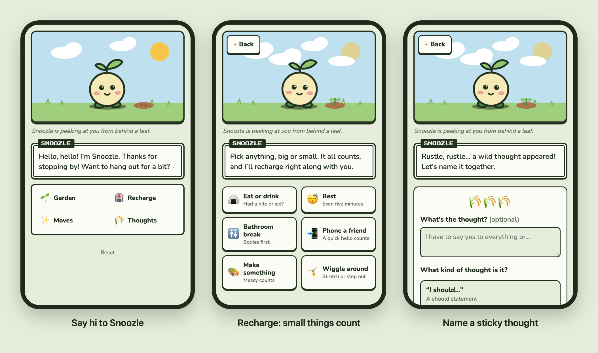

# Snoozle's Garden

Gentle nudges to check how much capacity you have today. Capacity changes with your feelings, like
weather, so Snoozle asks what your sky looks like and helps you size the day to match.

Try it on your phone: [snoozle.pages.dev](https://snoozle.pages.dev)



## What you can do

- **Garden:** pick today's sky, from sunny to stormy, as a quick mood check-in. Every kind of weather grows the garden.
- **Recharge:** six small acts of care (eat, rest, a bathroom break, phone a friend, make something, wiggle). Each one counts.
- **Moves:** today's to-dos, sized to the weather. A stormy day gets fewer moves than your usual, and extras are saved for later.
- **Thoughts:** name a sticky thought and the thinking trap behind it ("I should…", "It'll all go wrong").

## Product decisions

| Decision | Why | Trade-off |
|---|---|---|
| No accounts; nothing stored except saved moves; the day resets at midnight | Private by default, nothing to sign up for | Friendship and thoughts don't carry over (next: export to a "Garden Code") |
| One static page, no framework, ≤ 20 KB compressed | Loads in under 2 s on a slow phone connection; free hosting | Everything is hand-built |
| Cut the menu animation | Saves ~0.7 s on every tap | Less flourish |
| Accessibility pass after v1 | Test the core loop with people first | Known gaps are listed in [PLAN.md](PLAN.md) |

## How it's built

One static `public/index.html` with vanilla JS and CSS, no build step, no backend. Details: [ARCHITECTURE.md](ARCHITECTURE.md).

## Run locally

```sh
python3 -m http.server -d public 8000
```

Open <http://localhost:8000> (use your browser's device toolbar for phone widths). Any static server works;
serve over HTTP rather than opening the file directly. `public/_headers` (the CSP) only applies on Cloudflare Pages.

## Checks

Needs Node ≥ 20.6 and an installed Google Chrome. Run `npm install` once.

| Command | What it checks |
|---|---|
| `npm run gate:fast` | Docs links, size budget, copy, sprites, colour tokens (< 2 s) |
| `npm run gate` | `gate:fast` + browser flows at 320/390/460 px; run before every commit |
| `npm run perf` | Lighthouse on simulated Slow 4G; needs network for fonts |

## Docs

- [PLAN.md](PLAN.md): status and decisions.
- [ARCHITECTURE.md](ARCHITECTURE.md): how it's built.
- [CLAUDE.md](CLAUDE.md): agent brief and constraints.

## Built with Claude Code

Built in two days with [Claude Code](https://claude.com/claude-code): 70 of 71 commits are
co-authored by Claude. I set the goals, the constraints and the copy and reviewed every change;
Claude planned, built and tested inside them.

- [CLAUDE.md](CLAUDE.md) is the brief Claude works from: constraints, gates, lessons.
- [PLAN.md](PLAN.md) has every decision, dated.
- `npm run gate` runs before every commit.
- The workflow (skills, hooks, review gates) is in [claude-config](https://github.com/schen22/claude-config).

## License

[MIT](LICENSE).
